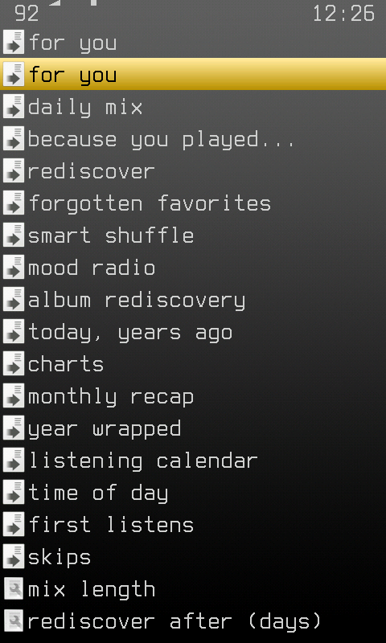
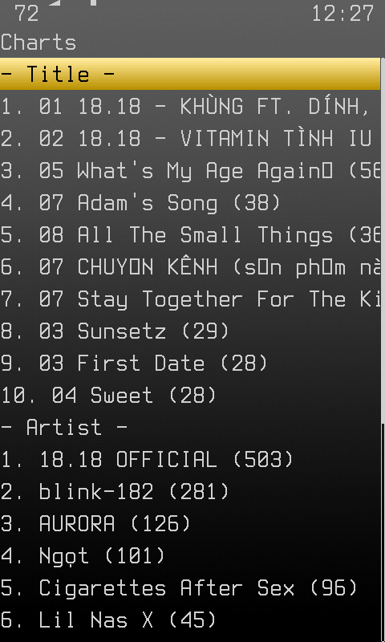
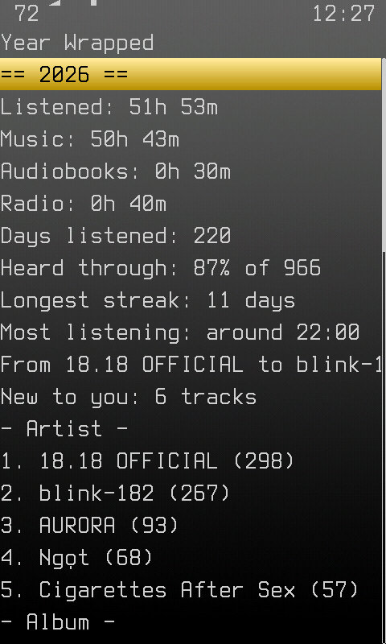
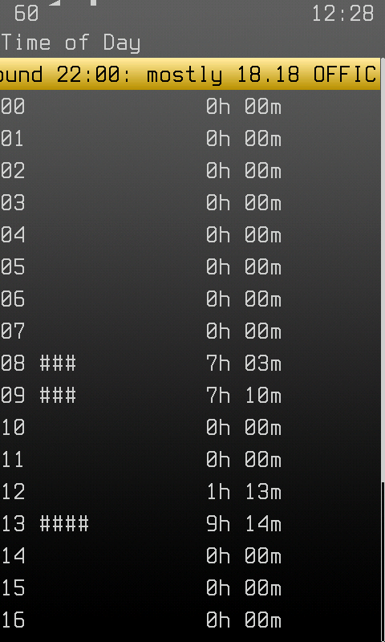

# For You

Mixes, charts and recaps made from the [listening log](listening-history.md),
on the main menu as **For You**. Nothing is computed in the background: a
screen reads the log when it is opened, and nothing runs while music plays.

There are no ratings. A track heard through counts for it, a track skipped
counts against it, and a track skipped more than it is heard is picked less
and less. "Heard" is finished, or at least half played.

| The menu | Charts | Year Wrapped | Time of Day |
| --- | --- | --- | --- |
|  |  |  |  |

## Mixes

Each one writes `/.rockbox/foryou.m3u8` and plays it. No artist comes twice
in a row where the tracks allow it.

| Entry | What plays |
| --- | --- |
| For You | What you like, weighted against what you heard today and towards what you have not heard for two weeks. A fifth of it is tracks never played. |
| Daily Mix | 70% familiar, 20% played once or twice, 10% never played. |
| Because You Played... | Around the track that is playing, or the last one heard: the same artist, and tracks you tend to play within half an hour of it. |
| Rediscover | Tracks not heard for *Rediscover After* days. |
| Forgotten Favorites | The same, of tracks heard through at least five times. |
| Smart Shuffle | The playlist that is on, reshuffled: no artist twice in a row, and the tracks you keep skipping at the end. Up to 2000 tracks. |
| Mood Radio | Chill, Energetic, Driving or Relaxing, by words in the genre tag. |
| Album Rediscovery | Albums heard at least three times and not for *Rediscover After* days, with how many days. Select one to play it. |
| Today, Years Ago | What was played on this day in earlier years. |

Tracks never played and Mood Radio come from the database, so they need it
initialised. Something added in the last month is three times as likely to be
the never-played pick.

## Numbers

| Entry | What it shows |
| --- | --- |
| Charts | Top 10 tracks, artists and albums: this week, month, year, or all time. |
| Monthly Recap | This month and the last: time listened (music, audiobooks, radio), days listened, share heard through, tracks new to you, top 3 of each. |
| Year Wrapped | The same for this year and the last, with the longest streak, the hour you listen most, and the artist you moved from and to between its halves. |
| Listening Calendar | Current and best streak, weeks in a row, and a mark for each day of the last year: `.` none, `-` under 30 minutes, `+` under two hours, `#` more. |
| Time of Day | Listening by hour, and the artist you play most at your busiest hour. |
| First Listens | Tracks heard for the first time this month and this year. |
| Skips | Share heard through, and the tracks skipped most. |

A track or album on these screens plays when selected.

## Settings

*Mix Length* (10 to 50 tracks, 20) and *Rediscover After* (30 to 360 days,
90), at the bottom of the menu.

## Limits

* The folder a track is in is its album and the folder above that its
  artist, and names on screen are file and folder names, not tags.
* Only music counts in mixes and charts. Audiobooks and radio are in the
  totals.
* Everything starts when the log does: a recap or a "years ago" cannot show
  what was played before listening history was on.
* 6144 different tracks are counted; a library with more listened-to tracks
  than that leaves the rest out.
* Mood is a guess from genre words until something writes a better tag.
