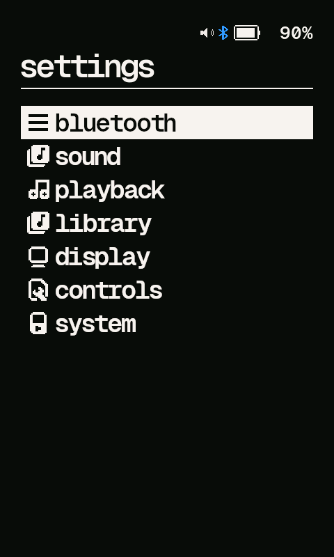

# Wi-Fi

Settings > **Wi-Fi** brings the R1's radio up the way HiBy OS does: `wpa_supplicant`
joins a network and `udhcpc` asks it for an address. The bootloader takes the Wi-Fi
chip away from its driver before Rockbox starts, so switching on gives it back and
switching off lets go again. Nothing listens on the network - Rockbox only ever
talks out.

* **Wi-Fi: On/Off** - select to switch it. It starts off on every boot: the radio
  is the biggest battery cost the player has, so leave it off when nothing needs it.
* **Network** - select to scan. Pick a network to join; a secured one asks for its
  password on the keyboard. Saved networks are starred and are joined on their own
  next time Wi-Fi comes on. Long-press a saved one to forget it. A password that
  fails is not kept.
* **IP Address** - what the network gave the player.
* **Update Rockbox** - see below.

If the radio does not come up, the reason is written to `rockbox-wifi-debug.log` in
the root of the card.

## Updating over Wi-Fi

**Update Rockbox** asks GitHub which release of this fork is the latest. If it is
not the one installed, it offers it, downloads `rockbox-hibyr1-<version>-sdcard.zip`
(about 30 MB: firmware, fonts, themes), unpacks it over the card and restarts.
Playback stops while it works. Settings, the database and music are not in the
archive and stay as they are. A download that fails or is cut short changes nothing.

The player only needs a way out to the internet, so either of these works:

* **iPhone** - turn on Personal Hotspot (with *Maximise Compatibility*: the R1 is
  2.4 GHz only) and join it from **Network**.
* **Laptop** - join the same Wi-Fi as the laptop, or the laptop's own hotspot.

To install a build that is not a release - one made on the laptop, or downloaded
from CI - serve the zip from the laptop and tell the player where it is:

```sh
python3 -m http.server 8000        # in the folder holding rockbox.zip
```

and put the address in `/.rockbox/update.url`, one line:

```
http://192.168.1.20:8000/rockbox.zip
```

A second line, if there is one, is the SHA-256 the zip must have (`sha256sum
rockbox.zip` on the laptop, lower case as printed); a download that does not match
is thrown away. Without it the player installs whatever that address serves.

```
http://192.168.1.20:8000/rockbox.zip
9f86d081884c7d659a2feac5c3f1e0a8b4f1b2b0b822cd15d6c15b0f00a08f3e
```

While that file exists **Update Rockbox** installs from it, whatever the version;
delete it to go back to releases.

The download is not authenticated: the player's `wget` speaks HTTPS but cannot check
certificates, and a release is not checked against anything. Update on a network
you trust.

Networks and passwords are kept by `wpa_supplicant` in `/.rockbox/wifi.conf`, in plain
text, like HiBy OS keeps its own.

Wi-Fi is at the top of Settings. To put it on the main menu as well, show it in
Settings > Controls > Main Menu Layout.



This is the base for internet radio, clock sync and the rest of [#29](https://github.com/WillNHT/rockbox-hiby-r1/issues/29).
